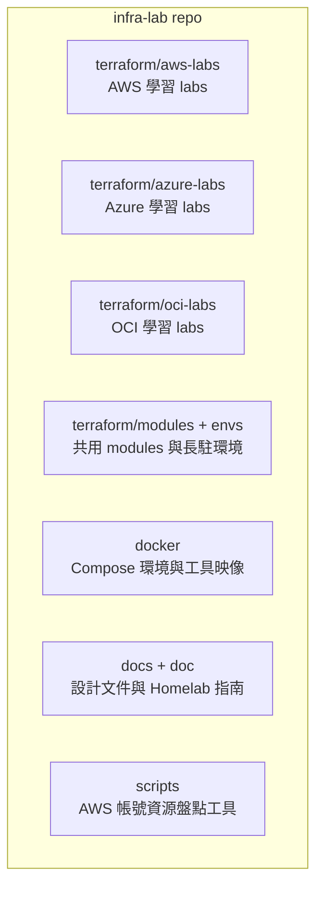

# infra-lab

Infrastructure-as-Code playground — AWS, Azure, and OCI Terraform labs, reusable infrastructure, Docker stacks, and homelab documentation.

基礎設施即程式碼練習場 — 涵蓋 AWS、Azure、OCI Terraform labs、可重用基礎設施、Docker 環境，以及 Homelab 技術文件。

---

## 專案總覽



---

## 目錄結構

```
infra-lab/
├── docker/                       # 本機 Compose 環境與工具映像
│   ├── <stack>/                  # 每個 Compose stack 預設使用 compose.yaml
│   ├── aws-terraform/            # Terraform、AWS CLI 與 SAM 映像
│   └── azure-terraform/          # Terraform 與 Azure CLI 映像
├── terraform/
│   ├── aws-labs/                 # AWS 學習 labs
│   ├── azure-labs/               # Azure 學習 labs
│   ├── oci-labs/                 # OCI 學習 labs
│   ├── modules/                  # 可重用 Terraform modules
│   ├── envs/                     # 獨立的長駐環境
│   └── docs/                     # Terraform 學習路線與文件
├── docs/superpowers/             # 設計規格與實作計畫
├── doc/                          # Homelab 建置指南
├── scripts/aws-inventory/        # AWS 帳號資源盤點工具
└── README.md
```

---

## Terraform 與 Docker 導覽

- **[`terraform/aws-labs/`](terraform/aws-labs/)** — 編號式 AWS 練習；每個 lab 有自己的 README 與 Terraform root。
- **[`terraform/azure-labs/`](terraform/azure-labs/)** — Azure labs，著重與 AWS 服務對照。
- **[`terraform/oci-labs/`](terraform/oci-labs/)** — OCI labs，另有需保護的長駐 OCI environments，見 `terraform/envs/oci-*`。
- **[`terraform/modules/`](terraform/modules/)** — 可重用的 AWS、Azure 等 Terraform modules。
- **[`terraform/envs/`](terraform/envs/)** — 各自管理 state 的長駐環境；操作前先閱讀 [`terraform/agents.md`](terraform/agents.md) 和該環境現有文件。
- **[`docker/`](docker/)** — 本機資料庫、開發服務與工具映像；Compose 目錄索引與操作方式見 [`docker/README.md`](docker/README.md)。

---

## Related Repositories / 相關專案

| Repo | Description |
|------|-------------|
| [`k3s-gitops`](https://github.com/changken/k3s-gitops) | ArgoCD manifests for GitOps-managed deployments on K3s cluster<br/>K3s 叢集上由 ArgoCD 管理的 GitOps 部署清單 |
| [`draw-card-app`](https://github.com/changken/draw-card-app) | Full-stack card drawing app with CI/CD pipeline deploying to K3s<br/>全端抽卡應用程式，CI/CD 自動部署至 K3s |
| [`serverless-wallet-api`](https://github.com/changken/serverless-wallet-api) | Serverless expense tracking API on AWS Lambda<br/>基於 AWS Lambda 的 Serverless 記帳 API |

---

## Tech Stack / 技術棧

- **IaC:** Terraform (modularized, multi-cloud)
- **Container Orchestration:** K3s (Rancher)
- **GitOps:** ArgoCD
- **Cloud Providers:** AWS, Azure, OCI, and selected VPS providers
- **Databases and data services:** PostgreSQL, Oracle, Redis, Doltgres, MinIO, and Supabase
- **Observability:** Prometheus, Grafana, Loki, CloudWatch
- **Networking:** MetalLB, Gateway API, cert-manager, Tailscale
- **CI/CD:** GitHub Actions, GHCR

---

## Design Decisions / 設計決策

| Decision / 決策 | Why / 原因 |
|---|---|
| K3s over EKS/AKS | Lower cost, deeper learning — managing the control plane yourself teaches more than a managed service<br/>成本更低、學得更深 — 自己管 control plane 比用託管服務學到更多 |
| Hetzner ARM instances | CAX11/CAX21 offer the best price-performance for homelab workloads<br/>CAX11/CAX21 在 homelab 場景下性價比最高 |
| Spot Instances for Windows | Up to 90% cost savings; SSM eliminates SSH key management overhead<br/>最高省 90% 成本；SSM 省去 SSH key 管理負擔 |
| Terraform modules over flat configs | Reusability + env separation; mirrors real-world team workflows<br/>可重用 + 環境分離；符合實際團隊工作流程 |
| Multi-cloud modules | Not for production redundancy — for learning different provider APIs and demonstrating portability<br/>非為生產冗餘 — 而是學習不同雲端 API 並展示可攜性 |

---

## 快速開始

```bash
# 複製專案
git clone https://github.com/changken/infra-lab.git
cd infra-lab

# 範例：從第一個 AWS lab 開始
cd terraform/aws-labs/01-ec2-web-server
cp terraform.tfvars.example terraform.tfvars
# 閱讀 lab README，再編輯 terraform.tfvars
terraform init
terraform fmt -check
terraform validate
terraform plan
```

> ⚠️ 執行 `terraform apply` 前，請先閱讀該 lab 的費用估算並檢查 plan；練習結束後清除暫時建立的資源。

---

## License

MIT
