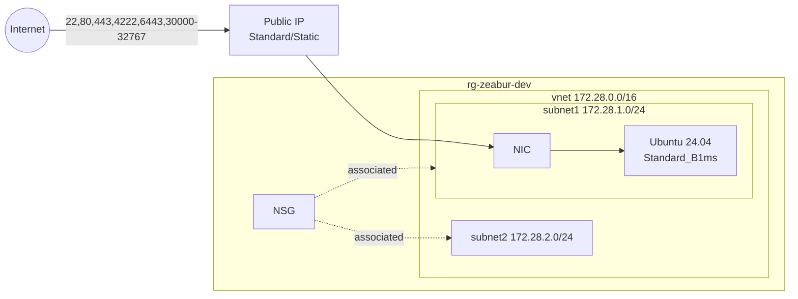

# Zeabur Dedicated Server on Azure (Terraform)

Ubuntu 24.04 VM + VNet (172.28.0.0/16, 2 subnets) + NSG（Zeabur 所需 ports）+ Terraform 產生的 ED25519 SSH key。



## 檔案結構

| File | 內容 |
|---|---|
| `versions.tf` | Terraform / provider 版本、backend |
| `providers.tf` | azurerm provider |
| `variables.tf` | 所有 input |
| `locals.tf` | 命名、tags、NSG port 表 |
| `main.tf` | Resource Group |
| `network.tf` | VNet、Subnets、NSG、NSG association |
| `ssh.tf` | ED25519 key 產生並寫到 `.ssh/` |
| `compute.tf` | Public IP、NIC、Linux VM |
| `outputs.tf` | IP、ssh 指令、private key |

## 使用

```bash
az login
cp terraform.tfvars.example terraform.tfvars   # 填 subscription_id
terraform init
terraform plan -out tfplan
terraform apply tfplan

# 測試登入
$(terraform output -raw ssh_command)

# 貼到 Zeabur「Connect your own Server」的 SSH key 欄位
terraform output -raw ssh_private_key_openssh
```

Zeabur 註冊時填：IP = `vm_public_ip`、Port = `22`、User = `azureuser`、SSH key = 上面輸出。

## 注意

- Private key 會存在 **tfstate** 和 `.ssh/`，兩者都別進 git；團隊用請改 remote backend。
- `allowed_source_prefix = "*"` 代表 22 / 6443 對全世界開，跑起來後建議收斂。
- Azure 不允許 `root` 當 admin，但用 SSH key 建立的 admin user 預設 NOPASSWD sudo，符合 Zeabur 要求。
